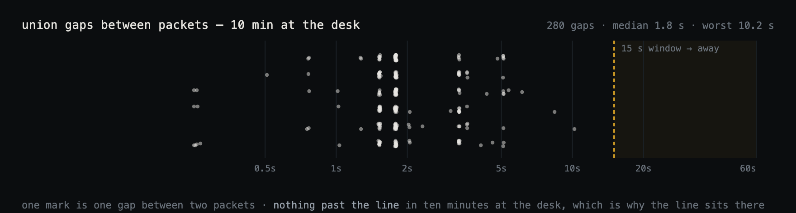
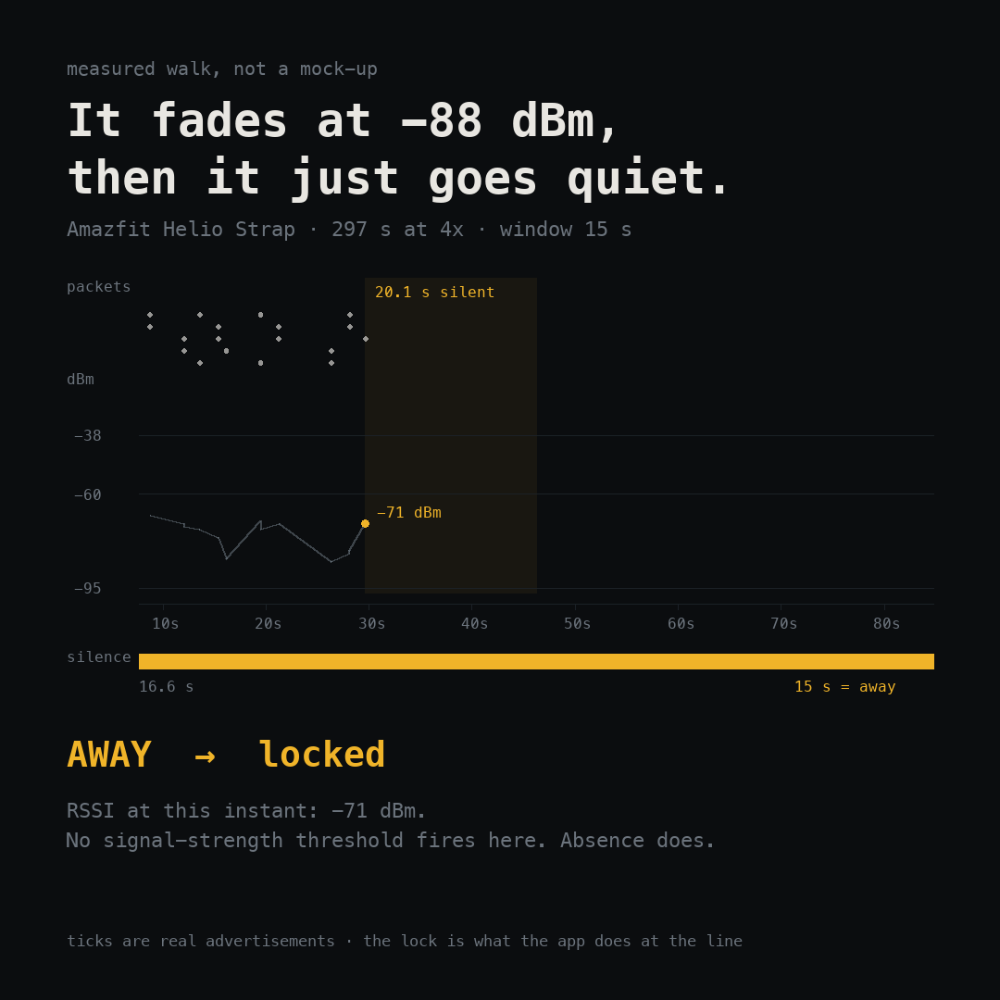

# Waylock

Waylock pairs with one Bluetooth device you already carry and locks your Mac when that device's advertisements have been silent for a window measured on your own desk.

<a href="https://github.com/hheydaroff/waylock-mac/actions/workflows/ci.yml"></a>
<a href="LICENSE"></a>


It keys on absence, not signal strength, because on earbuds signal strength does not work. Tested with a Galaxy Buds3 Pro and an Amazfit Helio Strap on macOS 27.0.1 (M4 Max).



Those are ten real minutes of a key device sitting at the desk, and they are the entire argument for the default: the device is silent for 1.8 s at a time, occasionally 5 s, once 10.2 s. A 10 s window locks the Mac while you are still sitting there. **Slide the window across the trace yourself: [heyhido.com/waylock-mac](https://heyhido.com/waylock-mac/)** — no build, no dependencies, one file ([source](docs/window-simulator.html)).

[](docs/assets/walk-away.mp4)

Fifteen seconds of an actual walk-away, played at 4× ([mp4](docs/assets/walk-away.mp4), 200 KB): the strap fades to −88 dBm, goes silent for 20 s, and the Mac locks — while the last thing the radio said was a perfectly civil signal strength. `scripts/walk-animation.py` draws it from a `waylock-watch` recording, and refuses to render if no silence in the log actually clears the window.

## What you see

Click the menu bar item while the key device is nearby:

```text
Armed — key is present
Amazfit Helio Strap · -57 dBm · 1s ago
─────────────────────────────
✓ Enabled
  Away for                      ▸  Automatic · learned 12 s
                                   ─────────────────────────
                                   8 seconds · may false-lock
                                   10 seconds · may false-lock
                                   15 seconds
                                   20 seconds
                                   30 seconds
  Key Device                    ▸  (named advertisers, rebuilt on open)
  Don't lock while I'm typing
─────────────────────────────
  Lock Now (test)
  Start at Login
  Restart Scanning
─────────────────────────────
  Quit Waylock
```

The status line also reads `Key is away…`, `Locked`, `Waiting for key device`, `Waiting for Bluetooth permission` or `Bluetooth unavailable`, and it is prefixed `DRY RUN · ` when the lock is disabled for testing. The log shows what happens when you walk away (`~/Library/Logs/Waylock.log`, local time, Galaxy Buds3 Pro in your ears):

```text
2026-10-19 17:17:11  hb absent=11.0s phase=armed ch=3 idle=43s locked=0   <- counting up
2026-10-19 17:17:15  AWAY 15s -> locking
2026-10-19 17:17:15  lock: confirmed (rc=0)                              <- verified, not assumed
2026-10-19 17:17:22  hb absent=21.5s phase=lockedOut locked=1
2026-10-19 17:17:22  re-armed: key back                                  <- Touch ID, buds back
2026-10-19 17:17:32  hb absent=0.4s phase=armed locked=0
```

## Quick start

```sh
swift test
./build.sh
open build/Waylock.app
```

The first launch asks for Bluetooth permission; approve it from an unlocked screen. Every rebuild changes the code signature, so the next launch asks again.

## What this is not

- **It does not measure distance.** It locks when the key device goes out of Bluetooth LE range, which is not a distance you choose.
- **It is not a security control.** Leave the key device on your desk and the Mac stays unlocked: it fails open.
- **It calls a private API** (`SACLockScreenImmediate`), so it cannot ship on the App Store. This is a personal build.
- **It is ad-hoc signed.** No notarization, and macOS treats each rebuild as a new app.

## How the window is chosen

The window is the only real tuning parameter, and it was set from the distribution of the gap between advertisements on any key channel, not from intuition. 600 samples over 10 minutes at the desk:

| median | p90 | p95 | p99 | max |
|---|---|---|---|---|
| 1.0 s | 3.3 s | 4.5 s | 7.6 s | 10.2 s |

A 10 s window false-locked a seated user (t=145 s); a 15 s window did not. The default is 15 s, 47% above the worst gap observed. Walk-away silence is unbounded once you leave, so a wider window costs a few seconds of latency, never a missed lock.

The window is then learned per device. It settles after 180 s on a new key device, at `worst gap x 1.5` clamped to 12-60 s. To re-measure a device, run `swift run waylock-tools --calibrate 10` (read only; add `--apply` to keep the result). The full derivation, the dead ends and the corrections are in [FINDINGS.md](FINDINGS.md).

<details>
<summary>Choosing a key device</summary>

Menu -> **Key Device** lists every advertiser that announces a name, with live RSSI and measured rate, for example `Amazfit Helio Strap  -57 dBm  40/min`. The tick marks the one in use. Anything under about 12/min is flagged `too rare`: a device heard every 11 s cannot support a usable window, and the menu is a better place to learn that than a walk-away test. Picking a device clears the learned address set, because those addresses belonged to the previous one. `Type a name…` takes a name the list does not show.

Matching is a case-insensitive substring of the advertised name, so `buds3` covers both `Buds3 Pro` and `Buds3 Pro de <owner>`, and address rotation needs no special handling.

A device needs two things: it advertises a name, and its window gets measured rather than guessed. Advertising rate differs by up to 5x between devices, so the window is learned per device:

| Stage | Window | Why |
|---|---|---|
| First 3 min on a new device | 20 s (warm-up) | slack on purpose: slow to lock costs seconds, fast costs a locked screen |
| After ~3 min and 20+ gaps | learned | `worst gap x 1.5`, clamped to 12-60 s |
| You pick one by hand | yours | always wins; "Automatic" in the menu goes back to measurement |

Gaps beyond 10x the median are discarded as absences rather than learned as behavior, so a 45 s trip to a meeting does not teach the app that 45 s is normal. Measured so far: the strap gives **12 s** (the floor) and the Buds3 Pro gives **15.3 s** from a 10.2 s worst case. Those match the values hand-tuned before any of this was automated.

```sh
swift run waylock-tools --calibrate 10           # measure and show the distribution, read only
swift run waylock-tools --calibrate 10 --apply   # keep the result
swift run waylock-tools --export-gaps 10 --out /tmp/gaps.json   # the raw gaps, for the page below
swift run waylock-scan 150                       # list every advertiser for 150 s
swift run waylock-watch "Amazfit" 60             # watch one named device for 60 s
```

The picture at the top of this README is not an illustration, it is one of those runs: `--export-gaps` writes the raw gap list, `scripts/embed_trace.py` inlines it into [`docs/window-simulator.html`](docs/window-simulator.html) and the two chart sources, and `scripts/render-social-preview.sh` renders the committed PNGs with headless Chrome. The committed trace is `docs/data/trace-amazfit-helio-strap.json` (timings only, no device identifiers), so you can re-render every number in it without owning the hardware.

</details>

<details>
<summary>Why phones and the Apple Watch mostly do not work</summary>

Phones and watches advertise no name, so they cannot be picked. A 150 s scan found 116 Apple beacons, every one nameless, across 7+ rotating addresses. The iPhone and Watch appear only as anonymous Continuity and Find My payloads, with nothing to distinguish yours from a neighbor's iPhone. The name appears only after bonding, and whether CoreBluetooth then hands back a stable identifier is untested. Devices that name themselves and advertise continuously (earbuds, a fitness band) are the workable keys.

Why not RSSI thresholds: sitting still at the desk, the buds wandered between -70 and -83 dBm, and on re-entry read -89 dBm while the wearer was back at the desk. Your own head blocks 2.4 GHz, so any fixed threshold either fires while you sit still or only after you have left the building. A stationary, non-worn device on the same Mac measured -75.8 dBm ± 1.6 dB over 60 s.

What else was ruled out on this machine: `IOBluetoothDevice.rawRSSI()` returns 0, `system_profiler` reports RSSI only for a connected device, and `CGSession -suspend` is gone. CoreBluetooth does report advertisement RSSI, and `SACLockScreenImmediate` resolves from `login.framework` and works. RSSI cannot tell 5 m from 0 m on earbuds.

Why not one channel: the buds advertise three independent streams (`Buds3 Pro`, `Buds3 Pro de <owner>`, `Galaxy Buds3 Pro (XXXX) LE`). Each goes quiet for up to 31 s while you sit at the desk, and a single-channel detector falsely locked 5 times in 3 minutes. They almost never go quiet together, so the rule is all channels absent, which also survives address rotation and brief occlusion. Audio playback roughly halves the packet rate (0.9 Hz to 0.47 Hz); the window absorbs that.

</details>

<details>
<summary>When someone else owns the same model</summary>

Name matching alone fails open: a colleague's `Amazfit Helio Strap` is another matching channel, the union never goes absent, and the Mac stays unlocked while you walk away. So the app learns the address set of the device you picked and accepts a name match only when

- the address is one it has learned, or
- no other same-named device is in range, which is the signature of a genuine rotation.

An impostor always shows up alongside yours, so it never gets learned. `swift test` verifies this deterministically, with no radio and no impostor hardware. Identity is name plus a learned address set, never a pinned UUID.

</details>

<details>
<summary>Heartbeat and log guide</summary>

`hb` lines are a 10 s heartbeat recording every input the decision uses: `absent`, `phase`, channel count, HID idle, `locked`, `enabled` and the window. They exist because the first live failure produced a log with nothing in it, which is indistinguishable from a dozen different causes.

```sh
tail -f ~/Library/Logs/Waylock.log
defaults read io.github.hheydaroff.waylock
```

Check `enabled=1` first: a disabled app scans, reports present and never locks. Then read `absent`. Climbing past the window with `locked=0` is a lock-API problem. Staying near zero means the key device is still in range, so it never left with you.

The same strap on a real walk-away, at-desk absence 2.3-2.6 s beforehand (steadier than the buds):

```text
17:57:55  hb absent=12.3s phase=armed      idle=43s   <- walking away
17:57:58  AWAY 15s -> locking
17:57:59  lock: confirmed (rc=0)
17:58:06  hb absent=22.8s phase=lockedOut  locked=1
17:58:12  re-armed: key back
```

Menu bar icon: `lock.open` armed, key present; `lock.rotation` key gone, counting down; `lock.fill` locked; `lock.slash` disabled or waiting for the key. To rehearse without locking, launch the app with `WAYLOCK_DRYRUN=1` in its environment: it logs `WOULD LOCK` and never locks. `swift run waylock-tools --selftest 60` runs the detection path against the real radio and prints to the terminal only.

</details>

<details>
<summary>Permissions and the code signature</summary>

`build.sh` signs ad hoc, and every build changes the signature. macOS keys the Bluetooth grant to that signature, so the next launch is a stranger and asks again. The evidence is in the system log, not in the app:

```text
tccd: Failed to match existing code requirement for io.github.hheydaroff.waylock
      service kTCCServiceBluetoothAlways
      cdhash H"6f8fa67b…"   <- the grant that exists
      cdhash H"a4f5597d…"   <- this build
tccd: AUTHREQ_PROMPTING
```

While the screen is locked the prompt cannot appear and CoreBluetooth never reports a state, which is why the menu says "Waiting for Bluetooth permission" instead of claiming all is well. Unlock and approve. Deny it and the menu reads "Bluetooth unavailable". The command-line runs are unaffected: `swift test` needs no Bluetooth, and `waylock-tools` inherits the terminal's grant.

To stop the prompts, sign with a stable identity once (needs a Keychain approval):

```sh
openssl req -x509 -newkey rsa:2048 -keyout /tmp/wl.key -out /tmp/wl.crt \
  -days 3650 -nodes -subj "/CN=Waylock Dev" \
  -addext "keyUsage=critical,digitalSignature" \
  -addext "extendedKeyUsage=critical,codeSigning" -addext "basicConstraints=critical,CA:false"
openssl pkcs12 -export -out /tmp/wl.p12 -inkey /tmp/wl.key -in /tmp/wl.crt -passout pass:
security import /tmp/wl.p12 -k ~/Library/Keychains/login.keychain-db -P "" -T /usr/bin/codesign
# then in build.sh: codesign -s "Waylock Dev" --force --identifier io.github.hheydaroff.waylock "$APP"
```

`Start at Login` needs the app in a stable location: copy it to `/Applications` first, or `SMAppService` refuses to register it.

</details>

<details>
<summary>Design rules</summary>

- **Never lock mid-keystroke.** The lock requires `HIDIdleTime` to have reached the whole window. It costs no latency, because the idle timer starts when the key signal dies, not when the decision is made.
- **Verify the lock.** `SACLockScreenImmediate` returns success even when nothing happened, so the app polls `CGSSessionScreenIsLocked` for 3 s and logs the truth.
- **Re-arm only on sustained presence.** After a lock it needs 3 s of continuous presence, so one stray packet does not re-arm it while you are away. A 20 s cooldown follows each lock.
- **Failures are loud.** CoreBluetooth that never reaches `poweredOn` looks identical to "the key is not here", so the radio state and every decision input are logged.

</details>

<details>
<summary>Known limits</summary>

- The key must be on and advertising. In the case, on the charger, powered off, or paired to another device first, there is no signal and the Mac locks. That is fail-safe, and it means opening the case at your desk re-arms it. Two failure modes any wearable shares: a key left behind keeps the Mac unlocked (fail-open), and a dead key battery locks it mid-sentence (fail-closed, which is why the activity gate exists).
- Bonded iPhones advertise continuously but may be replayed from the macOS cache, which would make absence-based detection impossible for them. Under investigation; see FINDINGS.md.
- A colleague with the same model is handled by the learned address set, but a device that rotates its address at the exact moment both of you are out of range could still confuse it. Not defended against.
- Warm-up fail-open: if the app launches while the key is out of range it has never seen one, so it sits at `noKey` and will not lock until the key is seen once. The alternative is locking the instant you launch it.
- The first 3 minutes on a new device lock late (20 s warm-up) while the window is measured.
- No auto-unlock. `login.framework` exports no unlock symbol, and injecting your password via Accessibility is not worth the attack surface. Touch ID stays the unlock path.

</details>

<details>
<summary>Build targets</summary>

No Xcode project: `./build.sh` runs `swiftc` and assembles the bundle by hand. One rule holds everywhere: Core never imports AppKit or CoreBluetooth.

| Target | Contents |
|---|---|
| `Core/` | the decisions: settings, window derivation, identity, tracking, the lock decision, menu copy |
| Adapters (`App/`) | CoreBluetooth, the lock API, UserDefaults, logging; the only code that talks to macOS |
| `Tools/` | the commands that need a real radio: `--selftest`, `--calibrate`, `--export-gaps`, `waylock-scan`, `waylock-watch` |
| `Tests/` | assertions against Core only: no radio, no permission prompt, no locking |
| App bundle | `build/Waylock.app`: Core, the adapters and the AppKit menu wiring, ad-hoc signed |
| `docs/` + `scripts/` | the window simulator, its chart sources, and the two scripts that keep them in step with a real trace |

Because the decisions are values rather than a menu bar app, a walk-away, a colleague's identical strap and a false lock at the desk all replay in milliseconds under `swift test`. `swift build` compiles the same targets without running anything.

</details>

<details>
<summary>Docs</summary>

- [CONTEXT.md](CONTEXT.md): glossary (key device, channel, sighting, arrival, away window)
- [FINDINGS.md](FINDINGS.md): the measurements, dead ends and corrections behind every constant
- [docs/adr/](docs/adr/): architecture decision records
- [AGENTS.md](AGENTS.md): the contract for coding agents working in this repo
- [CONTRIBUTING.md](CONTRIBUTING.md): how to build, test and send a change
- [SECURITY.md](SECURITY.md): threat model and how to report a vulnerability
- [LICENSE](LICENSE): MIT

</details>
